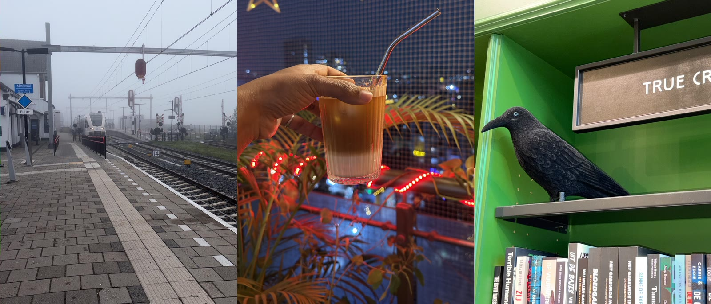

[Feyro](/feyro/) is a manual camera app for iPhone. It puts shutter speed, ISO, focus and white balance on dials, shoots ProRAW, RAW and 48 MP HEIF, and saves each photograph exactly as the camera produced it. It is on the [App Store](https://apps.apple.com/us/app/feyro/id6827645502).

It did not start that way.

## It started with 35 looks

The first build ran on October 24. By the end of that day it had 35 film looks, with halation, bloom, light leaks, an instant-film frame and a date stamp. There was a live look strip in the viewfinder, a look editor, and a card that suggested a look after each shot.

Two days later I added a mode called Natural. It took Apple's ProRAW and developed it inside the app, in HDR, with no sharpening and no local tone mapping. On an iPhone 16 Pro a 48 MP shot took about five seconds to develop and save, and each shot wrote about 100 MB to disk.

## Then I deleted the looks

On October 27 I removed the whole look pipeline: the looks, their colour science, the look editor, the Natural develop and the Metal kernels behind it. About 2,300 lines of app code and 1,400 lines of tests went with it.

What stayed is the camera, the controls, the viewfinder and the library. One rule replaced the looks: the saved photo is the camera's file. Feyro writes the HEIF, JPEG or DNG exactly as the camera delivered it, and a unit test compares the bytes.

My first priority for the capture code is image quality. Keeping the camera's own file, and not touching it, is how the app holds to that.

The numbers changed too. The HEIF is on disk 19 to 63 ms after the capture completes, and the capture call holds the main thread for under 2 ms.

## What is in it now

- **Dials** for shutter speed, ISO, focus and white balance, with third-stop shutter and ISO values.
- **Focus tools:** focus peaking and a live 4× focus loupe.
- **Exposure tools:** a luminance histogram, an RGB histogram, a waveform, and zebras.
- **Formats:** HEIF at up to 48 MP, Apple ProRAW, Bayer RAW (DNG) and JPEG.
- **Speed:** a Lock Screen and Control Center control, Camera Control, and the volume buttons as a shutter.
- **Privacy:** no account, no analytics, no server. Photographs stay on the iPhone unless you move them.

The app uses SwiftUI, AVFoundation, Photos and StoreKit 2, and no third-party packages.

## Free and Pro

Feyro is free to download. Manual exposure, manual focus, white balance, the RAW formats and the shooting tools are part of Feyro Pro. Pro costs $14.99 per year with a free trial for new subscribers, or $74.99 once. These are US App Store prices.

## What is next

Version 1.1.0 is with App Review as I write this. It adds three things:

- Compare SDR, Gentle HDR and Full HDR when you review a photo.
- Meter tripod exposure, for a stationary subject in low light.
- Apple ProRAW with lossless compression at the highest bit depth the camera offers.

Feyro needs iOS 18 or later. The [Feyro page](/feyro/) has the details, and the [support page](/feyro/support/) answers the common questions.
